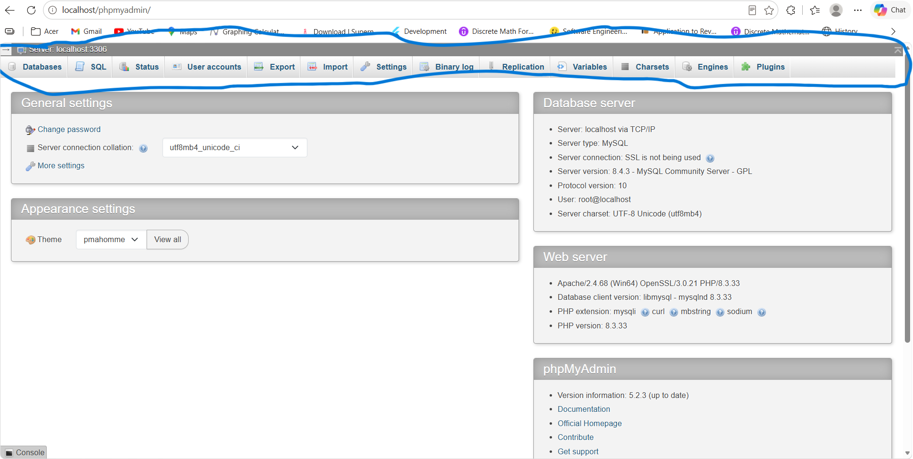
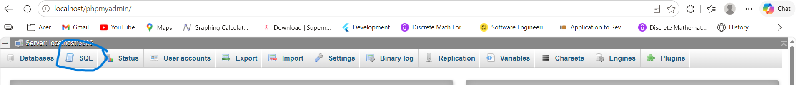

# REST API mini project: 📚 Perpustakaan(Flask & SQLAlchemy)
## 💻 System Requierement
     - Pyhton 3.10+(make sure to click the "Add Python to PATH" button befor download)
     - MySQL Database Server(you can use XAMPP or Laragon, but i use Laragon)
     - Postman(for API testing)
     - Vs code(Code editor) or you can also use Antigravity IDE(make sure the antigravity that you are download has a black background)
## 🗄  Database Configuration
1. Start Laragon. After installing Laragon, open the Laragon Control Panel and click Start All to start the required services.
2. Open phpMyAdmin. In the Laragon Control Panel, click Menu, select MySQL, and then click phpMyAdmin.
3. Log in to phpMyAdmin. Your browser will open the phpMyAdmin login page. By default, Laragon uses the following credentials:
    - Username: root
    - Password: Leave this field empty.
4. Enter root as the username, leave the password field blank, and click Log in.
5. When you finally login to the phpMyAdmin page, you will see this page:
   
7. In the navigation bar above, pick the "SQL" button, and it will lead you to the SQL Query Editor

    
    
    
    
    
8.In the the SQL Query Editor Create the database name "perpustakaan" with the following Query:

     CREATE DATABASE perpustakaan;
    
## 🚀 To run the application

### 1. Make a folder to make 
Create a new folder where you want to store your project.

For example, you can create a folder named ```Projects```.

### 2. Clone the Repository
Open your terminal (Command Prompt, PowerShell, or VS Code terminal) and run


For example, if you created GitHub Projects on your Desktop, run:
```
cd <Folder_location>\Projects
```
Next, run the following command to clone the repository from GitHub:

```
git clone https://github.com/Anya10032004/RestAPIMiniProject_Perpustakaan
```
Git will download the repository and create a new folder containing the project files.

### 3. Open the Project Folder
Next, enter the downloaded folder by running:

```
cd "<Folder_location>\RestAPIMiniProject_Perpustakaan"
```
### 4. Make a virtual enviroment
After that, we will make a virtual enviroment with a name perpustakaan, we will need to the following commands:

```
python -m venv perpustakaan
```

### 5. Activate the virtual enviroment
Commands to  activate the virtual enviroment is based on terminal you will use:

- Windows PowerShell:

   ```
   .\perpustakaan\Scripts\Activate.ps1
   ```
   
- Windows Command Prompt (CMD):
  
   ```
   .\perpustakaan\Scripts\Activate.ps1
   ```
   
- Git Bash / Linux / macOS:
  
  ```
  source perpustakaan/Scripts/activate
  ```
You can tell that the virtual environment is active when you see the prefix (perpustakaan) at the beginning of your terminal prompt.

### 6. Install the Required Libraries from ```requirements.txt```
After the virtual enviroment is active, we will need to install some libraries 
```
pip install -r requirements.txt
```

### 7. Configure the Database Connection
  Open main.py to the code editor(I will demonstrate how to use it with VS Code) from the terminal:

  ```
  cd "<Folder_location>\RestAPIMiniProject_Perpustakaan"
  code .
  ```

  and find the database connection configuration. Set it to the following URL:

        ```
        mysql+pymysql://root:@localhost:3306/perpustakaan
        ```
   | Component       | Value           | Description                                                                                                                                    |
   |-----------------|-----------------|------------------------------------------------------------------------------------------------------------------------------------------------|
   | Database Driver | `mysql+pymysql` | Specifies MySQL as the database and PyMySQL as the Python driver.                                                                              |
   | Username        | `root`          | The MySQL username used to connect to the database.                                                                                            |
   | Password        | Empty           | No password is configured for this setup.                                                                                                      |
   | Host            | `localhost`     | Connects to MySQL running on your own computer. If MySQL runs on another server, replace `localhost` with the server's IP address or hostname. |
   | Port            | `3306`          | The default MySQL port. Change it if your MySQL server uses a different port.                                                                  |
   | Database Name   | `perpustakaan`  | The name of the database created in Step 8.                                                                                                    |
   
   **Important**: Make sure the username, password, host, port, and database name match your MySQL configuration. If you use a password, add it after root: in the connection URL.
   
   **Note**: This configuration assumes MySQL is running locally and the root account has no password. For production environments, use a dedicated database user with a strong password instead of the root account.


### 8. Run the app

Run the ```app.py```:

    python main.py
    
If it works the output will be:

```
 * Serving Flask app 'main'
 * Debug mode: on
 * Running on http://127.0.0.1:5000 
```
The ```penulis```, ```kategori```, and ```buku``` tabbles will be automattically made when we run the app 
    
## ⚙️ API testing

### REST API Endpoint Summary

Base url: ```http://127.0.0.1:5000```

| No. | Module | Method | Endpoint | Description |
|---:|---|:---:|---|---|
| 1 | Home | `GET` | `/api` | Display the API welcome message |
| 2 | Author | `POST` | `/api/penulis` | Create a new author |
| 3 | Author | `GET` | `/api/penulis` | Retrieve all authors |
| 4 | Author | `GET` | `/api/penulis/{id_penulis}` | Retrieve an author by ID |
| 5 | Author | `PUT` | `/api/penulis/{id_penulis}` | Update an author's data by ID |
| 6 | Author | `DELETE` | `/api/penulis/{id_penulis}` | Delete an author by ID |
| 7 | Category | `POST` | `/api/kategori` | Create a new category |
| 8 | Category | `GET` | `/api/kategori` | Retrieve all categories |
| 9 | Category | `GET` | `/api/kategori/{id_kategori}` | Retrieve a category by ID |
| 10 | Category | `PUT` | `/api/kategori/{id_kategori}` | Update a category by ID |
| 11 | Category | `DELETE` | `/api/kategori/{id_kategori}` | Delete a category by ID |
| 12 | Book | `POST` | `/api/buku` | Create a new book |
| 13 | Book | `GET` | `/api/buku` | Retrieve all books |
| 14 | Book | `GET` | `/api/buku/{id_buku}` | Retrieve a book by ID |
| 15 | Book | `PUT` | `/api/buku/{id_buku}` | Update a book by ID |
| 16 | Book | `DELETE` | `/api/buku/{id_buku}` | Delete a book by ID |
| 17 | Book | `GET` | `/api/buku?penulis_id={penulis_id}` | Filter books by author ID |
| 18 | Book | `GET` | `/api/buku?kategori_id={kategori_id}` | Filter books by category ID |
| 19 | Book | `GET` | `/api/buku?q={judul}` | Search books by title |


### 1. Home API
 - Method: `GET`
 - URL: `http://127.0.0.1:5000/api `
 - Response Expected (200 OK):
   ```
   Welcome to the API
   ```
### 2. Author API
#### a. Create Author API
 - Method: `POST`
 - URL: `http://127.0.0.1:5000/create/penulis `
 - Body(JSON):
   ```
   {
    "nama_penulis": "Sefanya PN",
    "email": "sefanyapn@gmail.com"
   }
   ```
 - Response Expected:
   ```
   {
    "data": {
        "create_at": "2026-10-19T17:33:21",
        "email": "sefanyapn@gmail.com",
        "id_penulis": 4,
        "nama_penulis": "Sefanya PN"
    },
    "message": "Data berhasil ditambahkan",
    "status": 200
   }
   ```
#### b. Read Author API
 - Method: `GET`
 - URL: `http://127.0.0.1:5000/api/penulis `
 - Response Expected:
   ```
   {
    "data": [
        {
            "create_at": "2026-10-15T14:28:42",
            "email": "kakaa@gmail.com",
            "id_penulis": 2,
            "nama_penulis": "mama"
        },
        {
            "create_at": "2026-10-15T14:28:58",
            "email": "papakakaka@gmail.com",
            "id_penulis": 3,
            "nama_penulis": "alslda"
        },
        {
            "create_at": "2026-10-19T17:33:21",
            "email": "sefanyapn@gmail.com",
            "id_penulis": 4,
            "nama_penulis": "Sefanya PN"
        }
    ],
    "message": "Data berhasil diambil",
    "status": 200
   }
   ```
#### c. Read Author API based on ID
 - Method: `GET`
 - URL: `http://127.0.0.1:5000/api/penulis/2`
 - Response Expected:
   ```
   {
    "data": {
        "create_at": "2026-10-15T14:28:42",
        "email": "kakaa@gmail.com",
        "id_penulis": 2,
        "nama_penulis": "mama"
    },
    "message": "Data berhasil diambil",
    "status": 200
   }
   ```
#### d. Update Author API based on ID
- Method: `PUT`
 - URL: `http://127.0.0.1:5000/api/penulis/2`
 - Body(JSON):
   ```
   {
    "nama_penulis": "haha",
    "email": "haha@gmail.com"
   }

   ```
 - Response Expected:
   ```
   {
    "data": {
        "create_at": "2026-10-15T14:28:42",
        "email": "haha@gmail.com",
        "id_penulis": 2,
        "nama_penulis": "haha"
    },
    "message": "Data berhasil diupdate",
    "status": 200
   }
   ```
#### e. Delete Author API based on ID
- Method: `DELETE`
 - URL: `http://127.0.0.1:5000/api/penulis/4`
 - Response Expected:
    ```
    {
    "data": {
        "create_at": "2026-10-19T17:33:21",
        "email": "sefanyapn@gmail.com",
        "id_penulis": 4,
        "nama_penulis": "Sefanya PN"
    },
    "message": "Data berhasil dihapus",
    "status": 200
   }
    ```

### 3. Categori API
#### a. Create Categoty API
 - Method: `POST`
 - URL: `http://127.0.0.1:5000/create/penulis `
 - Body(JSON):
   ```
   {
    "nama_kategori": "romatic",
    "deskripsi": "Dunia milik kita berdua"
   }
   ```
 - Response Expected:
   
   ```
   {
   "message": "Data successfully added",
    "status": 200,
    "data": {
        "deskripsi": "Dunia milik kita berdua",
        "id_kategori": 5,
        "nama_kategori": "romatic"
    }
    
   }
   ```
#### b. Read Categoty API
- Method: `GET`
 - URL: `http://127.0.0.1:5000/api/kategori `
 - Response Expected:
   ```
   {

   "message": "Data berhasil diambil",
    "status": "success",
    "data": [
        {
            "deskripsi": "Ya hantu hantu atau mistis",
            "id_kategori": 1,
            "nama_kategori": "Horror Yassss"
        },
        {
            "deskripsi": "Intinya saat dua orang saling membantu dalam pertumbuhan atau jadi TOLOLL",
            "id_kategori": 2,
            "nama_kategori": "romantis"
        },
        {
            "deskripsi": "fiksi tetapi berisfat ilmiah",
            "id_kategori": 4,
            "nama_kategori": "sci-fi"
        },
        {
            "deskripsi": "Dunia milik kita berdua",
            "id_kategori": 5,
            "nama_kategori": "romatic"
        }
    ],
    
    }
    
   ```
#### c. Read Category API based on ID
 - Method: `GET`
 - URL: `http://127.0.0.1:5000/api/kategori/1`
 - Response Expected:
   ```
   {
   "message": "Data berhasil diambil",
    "status": "success",
    "data": {
        "deskripsi": "Ya hantu hantu atau mistis",
        "id_kategori": 1,
        "nama_kategori": "Horror Yassss"
    }
    
    }
   ```
#### d. Update Category API based on ID
- Method: `PUT`
 - URL: `http://127.0.0.1:5000/api/kategori/1`
 - Body(JSON):
   ```
   {
    "nama_kategori": "Horror YEYYYY",
    "deskripsi": "Bisa Hantu bisa penjahat"

   }
   ```
 - Response Expected:
```
{
  "message": "Data berhasil diupdate",
    "status": 200,
    "data": {
        "deskripsi": "Bisa Hantu bisa penjahat",
        "id_kategori": 1,
        "nama_kategori": "Horror YEYYYY"
    
   }
```

#### e. Delete Category API based on ID
 - Method: `DELETE`
 - URL: `http://127.0.0.1:5000/api/penulis/4`
 - Response Expected:

```
{
    "message": "Data berhasil dihapus",
    "status": 200,

    "data": {
        "deskripsi": "Dunia milik kita berdua",
        "id_kategori": 5,
        "nama_kategori": "romatic"
    }
    
   }
```

  

### 4. Book API
#### a. Create Book API
 - Method: `POST`
 - URL: `http://127.0.0.1:5000/api/buku `
 - Body(JSON):
   ```
   {
    "judul": "Shimbaa",
    "isbn": "12349494444912",
    "tahun_terbit": 2001,
    "harga": "2334000",
    "id_penulis": 3,
    "id_kategori": 4
   }
   ```
 - Response Expected:
   
   ```
   {
    "message": "Data successfully added",
    "status": "success",
    "data": {
        "harga": 2334000,
        "id_buku": 18,
        "id_kategori": 4,
        "id_penulis": 3,
        "isbn": "12349494444912",
        "judul": "Shimbaa",
        "tahun_terbit": 2001
    },
   }
   ```
#### b. Read Book API
- Method: `GET`
 - URL: `http://127.0.0.1:5000/api/buku`
 - Response Expected:
   ```
   {
   "message": "Data successfully retrived",
    "status": "success",
    "data": [
        {
            "harga": 10000,
            "id_buku": 1,
            "id_kategori": 1,
            "id_penulis": 2,
            "isbn": "123",
            "judul": "haha",
            "tahun_terbit": 2020
        },
        {
            "harga": 100000,
            "id_buku": 3,
            "id_kategori": 2,
            "id_penulis": 3,
            "isbn": "12344",
            "judul": "charles dickinson",
            "tahun_terbit": 2010
        },
        {
            "harga": 1334000,
            "id_buku": 4,
            "id_kategori": 1,
            "id_penulis": 3,
            "isbn": "1234sd4",
            "judul": "Harry Potter",
            "tahun_terbit": 2000
        },
        {
            "harga": 1334000,
            "id_buku": 5,
            "id_kategori": 1,
            "id_penulis": 3,
            "isbn": "123494949",
            "judul": "Hobbit",
            "tahun_terbit": 2000
        },
        {
            "harga": 2334000,
            "id_buku": 18,
            "id_kategori": 4,
            "id_penulis": 3,
            "isbn": "12349494444912",
            "judul": "Shimbaa",
            "tahun_terbit": 2001
        }
    ],
   }
    
   ```
#### c. Read Book API based on ID
 - Method: `GET`
 - URL: `http://127.0.0.1:5000/api/buku/3`
 - Response Expected:
   ```
   {
   "message": "Data successfully retrived",
    "status": "success",
    "data": {
        "harga": 100000,
        "id_buku": 3,
        "id_kategori": 2,
        "id_penulis": 3,
        "isbn": "12344",
        "judul": "charles dickinson",
        "tahun_terbit": 2010
    }
    }
   ```
#### d. Update Book API based on ID
- Method: `PUT`
 - URL: `http://127.0.0.1:5000/api/buku/4`
 - Body(JSON):
   ```
   {
    "judul": "Why haha is for laughing?"
   }
   ```
 - Response Expected:
```
{
    "message": "Data successfully updated",
    "status": "success",
    "data": {
        "harga": 1334000,
        "id_buku": 4,
        "id_kategori": 1,
        "id_penulis": 3,
        "isbn": "1234sd4",
        "judul": "Why haha is for laughing?",
        "tahun_terbit": 2000
    }
}
```

#### e. Delete Category API based on ID
 - Method: `DELETE`
 - URL: `http://127.0.0.1:5000/api/buku/3`
 - Response Expected:

```
{
     "message": "Data successfully deleted",
    "status": 200,
    "data": {
        "harga": 100000,
        "id_buku": 3,
        "id_kategori": 2,
        "id_penulis": 3,
        "isbn": "12344",
        "judul": "charles dickinson",
        "tahun_terbit": 2010
    }
}
```
#### f. Filter based on the Author ID
 - Method: `GET`
 - URL: `http://127.0.0.1:5000/api/buku?penulis_id=3`
 - Response Expected:
   ```
   {
   "message": "Data successfully retrived",
    "status": "success",
    "data": [
        {
            "harga": 100000,
            "id_buku": 3,
            "id_kategori": 2,
            "id_penulis": 3,
            "isbn": "12344",
            "judul": "charles dickinson",
            "tahun_terbit": 2010
        },
        {
            "harga": 1334000,
            "id_buku": 4,
            "id_kategori": 1,
            "id_penulis": 3,
            "isbn": "1234sd4",
            "judul": "Harry Potter",
            "tahun_terbit": 2000
        },
        {
            "harga": 1334000,
            "id_buku": 5,
            "id_kategori": 1,
            "id_penulis": 3,
            "isbn": "123494949",
            "judul": "Hobbit",
            "tahun_terbit": 2000
        },
        {
            "harga": 2334000,
            "id_buku": 18,
            "id_kategori": 4,
            "id_penulis": 3,
            "isbn": "12349494444912",
            "judul": "Shimbaa",
            "tahun_terbit": 2001
        }
    ]
   }
   ```

#### g. Filter based on the Category ID
 - Method: `GET`
 - URL: `http://127.0.0.1:5000/api/buku?kategori_id=1`
 - Response Expected:
   ```
   {
   "message": "Data successfully retrived",
    "status": "success",
    "data": [
        {
            "harga": 10000,
            "id_buku": 1,
            "id_kategori": 1,
            "id_penulis": 2,
            "isbn": "123",
            "judul": "haha",
            "tahun_terbit": 2020
        },
        {
            "harga": 1334000,
            "id_buku": 4,
            "id_kategori": 1,
            "id_penulis": 3,
            "isbn": "1234sd4",
            "judul": "Harry Potter",
            "tahun_terbit": 2000
        },
        {
            "harga": 1334000,
            "id_buku": 5,
            "id_kategori": 1,
            "id_penulis": 3,
            "isbn": "123494949",
            "judul": "Hobbit",
            "tahun_terbit": 2000
        }
    ]
   }
   ```
#### h. Filter based on the title or judul(q)
 - Method: `GET`
 - URL: `http://127.0.0.1:5000/api/buku?q=harry`
 - Response Expected:
   ```
   {
    "message": "Data successfully retrived",
    "status": "success",
    "data": [
        {
            "harga": 1334000,
            "id_buku": 4,
            "id_kategori": 1,
            "id_penulis": 3,
            "isbn": "1234sd4",
            "judul": "Harry Potter",
            "tahun_terbit": 2000
        },
        {
            "harga": 23340,
            "id_buku": 19,
            "id_kategori": 4,
            "id_penulis": 3,
            "isbn": "12349494444912111",
            "judul": "Harry osborn wow",
            "tahun_terbit": 2001
        }
    ]
   }
   ```
